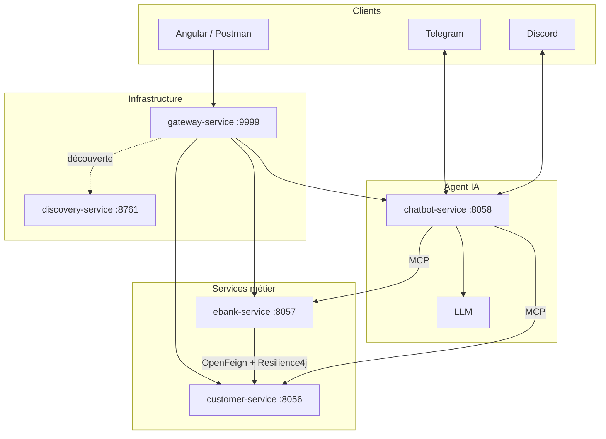

# ebank-agentic-microservices

Projet du module **Systèmes Distribués Agentiques** — Master SDIA, ENSET Mohammedia.

Application bancaire en architecture microservices avec **Spring Boot** et **Spring Cloud**, enrichie d'un **agent IA** (Spring AI) qui accède aux services via le **Model Context Protocol (MCP)**, et accessible depuis le web, Telegram et Discord.

## Architecture




## Méthode de travail

Le projet suit le **GitHub Flow** :

1. chaque tâche est une **issue**, rattachée à la milestone de sa partie ;
2. le travail se fait sur une **branche dédiée** (`feature/<n°>-<nom>`, `ci/<n°>-<nom>`...) ;
3. chaque branche est fusionnée dans `main` via une **Pull Request**, après réussite des tests ;
4. la branche `main` est protégée : aucun commit direct.

Les messages de commit suivent la convention [Conventional Commits](https://www.conventionalcommits.org/fr/) :

| Type | Usage |
|---|---|
| `feat` | Nouvelle fonctionnalité |
| `fix` | Correction de bug |
| `test` | Ajout ou modification de tests |
| `docs` | Documentation |
| `refactor` | Réorganisation du code, sans changement de comportement |
| `ci` | Intégration continue |
| `chore` | Maintenance et configuration |

## Parties du projet

### Partie 1 : microservices

- Développer `customer-service` (gestion des clients)
- Développer `ebank-service` (gestion des comptes bancaires)
- Faire communiquer les deux services avec **OpenFeign**
- Assurer la tolérance aux pannes avec un **Circuit Breaker** (Resilience4j)
- Développer le **Discovery Service** (Eureka)
- Développer la **Gateway** (Spring Cloud Gateway)
- Tester les services avec un client REST : Postman et Swagger UI

### Partie 2 : agent IA

- Développer l'agent IA avec **Spring AI**
- Exposer les fonctionnalités des microservices via **MCP**
- Tester les microservices avec un client MCP
- Connecter le chatbot aux microservices via MCP
- Tester le chatbot avec un client REST, un client **Telegram** et un client **Discord**

### Partie 3 : frontend

- Développer l'interface web avec **Angular**

Le suivi détaillé des tâches se trouve dans les [issues](../../issues) et les [milestones](../../milestones) du dépôt.

## Services

| Service | Port | Rôle |
|---|---|---|
| `discovery-service` | 8761 | Annuaire des services (Eureka) |
| `gateway-service` | 9999 | Point d'entrée unique, routage des requêtes |
| `customer-service` | 8056 | Gestion des clients |
| `ebank-service` | 8057 | Gestion des comptes bancaires |
| `chatbot-service` | 8058 | Agent IA (Spring AI, client MCP, Telegram, Discord) |
| `angular-front` | 4200 | Interface web |

## Stack technique

- **Langage :** Java 21
- **Framework :** Spring Boot 3.5.10, Spring Cloud, Spring AI
- **Build :** Maven (projet multi-modules)
- **Base de données :** H2 en mémoire
- **Documentation d'API :** springdoc-openapi (Swagger UI)
- **Tests :** JUnit 5, Mockito, AssertJ, MockMvc
- **Frontend :** Angular

## Lancer le projet

Prérequis : Java 21 et Maven.

```bash
git clone https://github.com/Taoufik-KEHAL/ebank-agentic-microservices.git
cd ebank-agentic-microservices
mvn clean verify
```

Chaque service se lance ensuite indépendamment : voir le README de chaque service.

## Auteur

**Taoufik KEHAL** — Master SDIA, ENSET Mohammedia
