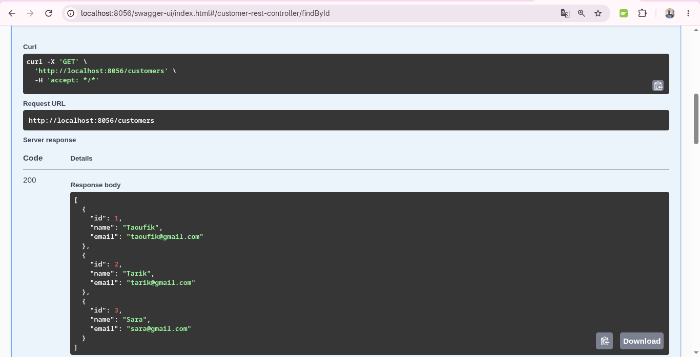
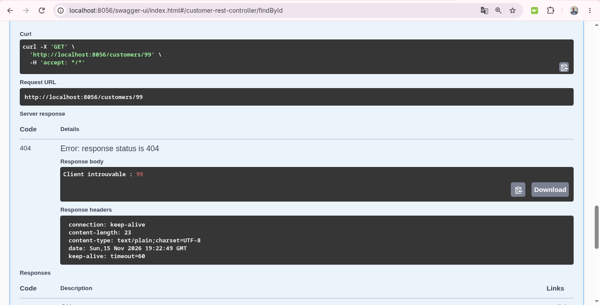
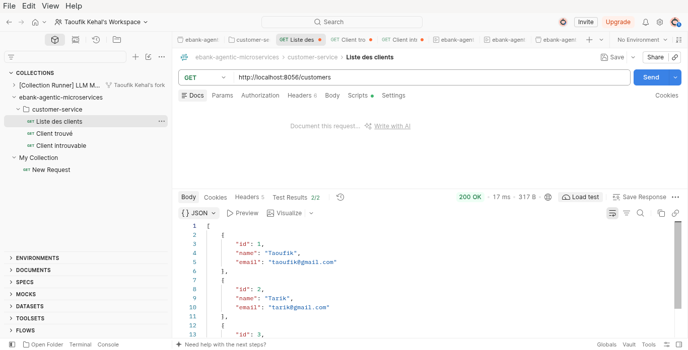
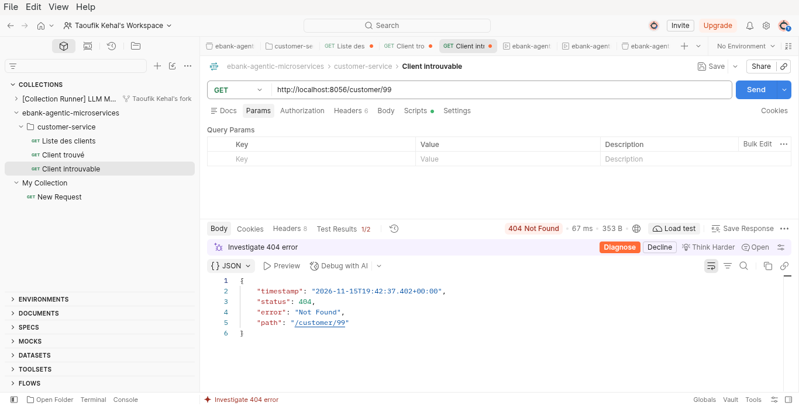

# customer-service

Microservice de gestion des clients du projet **ebank-agentic-microservices**.

## Rôle

`customer-service` gère les données des clients de la banque : il les stocke et les expose via une API REST.
Les autres services, comme `ebank-service`, n'accèdent jamais directement à sa base de données : ils passent obligatoirement par cette API.

## Caractéristiques

| Élément | Valeur |
|---|---|
| Port | `8056` |
| Java | 21 |
| Spring Boot | 3.5.10 |
| Base de données | H2 en mémoire |
| Documentation de l'API | http://localhost:8056/swagger-ui.html |
| Description OpenAPI (JSON) | http://localhost:8056/v3/api-docs |

## Architecture interne

Le service suit une architecture en couches, où chaque couche n'appelle que la couche située juste en dessous :

```text
Requête HTTP → Controller → Service → Repository → H2
```

| Package | Contenu | Rôle |
|---|---|---|
| `entity` | `Customer` | Entité JPA, mappée sur une table |
| `repository` | `CustomerRepository` | Accès aux données (Spring Data JPA) |
| `service` | `CustomerService` | Logique métier |
| `controller` | `CustomerRestController` | Endpoints REST |
| `exception` | `CustomerNotFoundException`, `GlobalExceptionHandler` | Erreurs métier et traduction en codes HTTP |
| `config` | `DataInitializer` | Données initiales au démarrage |

## Modèle de données

```json
{
  "id": 1,
  "name": "Taoufik",
  "email": "taoufik@gmail.com"
}
```

L'`id` est généré automatiquement par la base de données (`GenerationType.IDENTITY`).

## Endpoints

| Méthode | URL | Réponse |
|---|---|---|
| `GET` | `/customers` | **200** : liste des clients (`[]` si aucun client) |
| `GET` | `/customers/{id}` | **200** : le client demandé |
| `GET` | `/customers/{id}` | **404** : `Client introuvable : {id}` si le client n'existe pas |

### Gestion des erreurs

Un client introuvable est une **erreur métier**, pas une panne du serveur :

1. le service lève une `CustomerNotFoundException` ;
2. le `GlobalExceptionHandler` (`@RestControllerAdvice`) l'intercepte ;
3. il renvoie une réponse **404** avec le message de l'exception.

Sans ce gestionnaire, Spring renverrait une **500 Internal Server Error**.

## Données initiales

H2 est une base **en mémoire** : elle est vide à chaque démarrage.
La classe `DataInitializer` déclare un `CommandLineRunner`, exécuté une fois juste après le démarrage, qui insère trois clients de test : Taoufik, Tarik et Sara.

Cette initialisation est volontairement placée dans une classe `@Configuration` séparée, et non dans la classe principale `CustomerServiceApplication`.
Les tests de tranche comme `@WebMvcTest` chargent toujours les méthodes `@Bean` de la classe principale : un `CommandLineRunner` placé là réclamerait un `CustomerRepository` absent de la tranche web, et empêcherait les tests de démarrer.

## Lancer le service

Depuis la racine du projet :

```bash
mvn clean package
java -jar customer-service/target/customer-service-0.0.1-SNAPSHOT.jar
```

Le service est ensuite disponible sur http://localhost:8056.

## Tests

### Tests automatisés

```bash
mvn verify
```

| Classe de test | Type | Ce qu'elle vérifie |
|---|---|---|
| `CustomerRepositoryTest` | Intégration (`@DataJpaTest`) | Le mapping JPA de l'entité `Customer` |
| `CustomerServiceTest` | Unitaire (Mockito) | La logique métier, dont la levée de `CustomerNotFoundException` |
| `CustomerRestControllerTest` | Tranche web (`@WebMvcTest`) | Les URL, les codes HTTP, le JSON et la réponse 404 |
| `CustomerServiceApplicationTests` | Intégration (`@SpringBootTest`) | Le démarrage complet du contexte Spring |

Chaque niveau vérifie une responsabilité précise : ensemble, ils couvrent toute la chaîne, de la base de données jusqu'à la réponse HTTP.

### Tests manuels

#### Swagger UI

Liste des clients (200) :



Client introuvable (404) :



#### Postman

Liste des clients (200) :



Client introuvable (404) :



## Auteur

Taoufik KEHAL — Master SDIA, ENSET Mohammedia