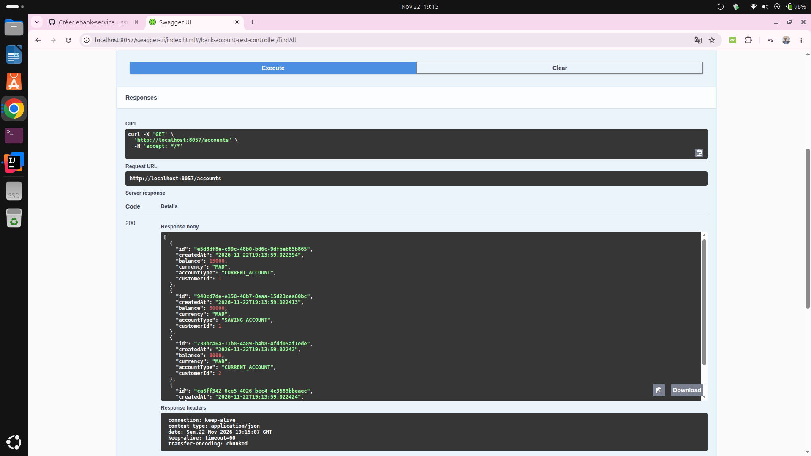
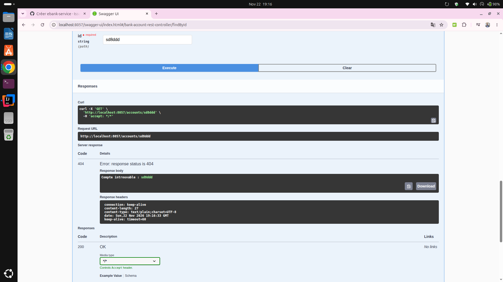
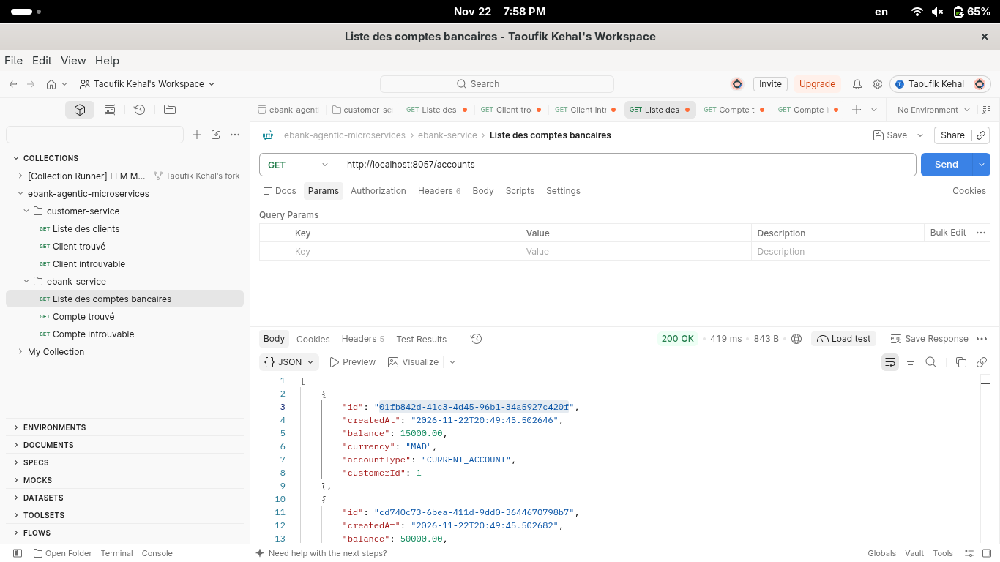
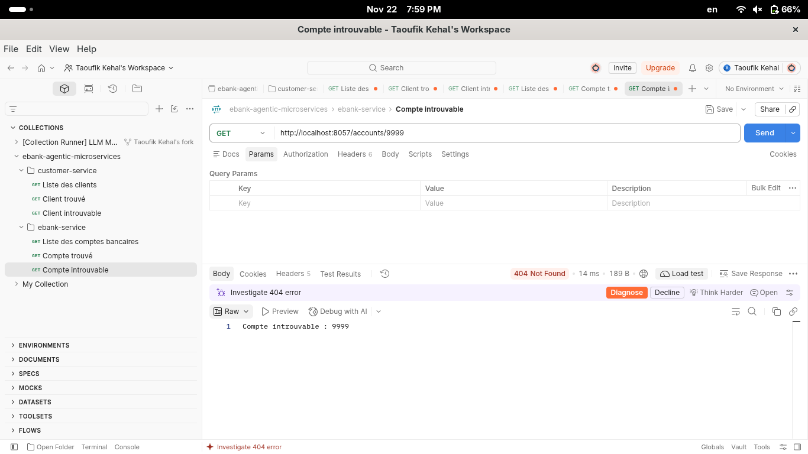

# ebank-service

Microservice de gestion des comptes bancaires du projet **ebank-agentic-microservices**.

## Rôle

`ebank-service` gère les comptes bancaires : il les stocke et les expose via une API REST.
Chaque compte appartient à un client géré par `customer-service`. Conformément au principe **Database per Service**, `ebank-service` ne stocke que l'identifiant du client (`customerId`) et n'accède jamais à la base de `customer-service`.

## Caractéristiques

| Élément | Valeur |
|---|---|
| Port | `8057` |
| Java | 21 |
| Spring Boot | 3.5.10 |
| Base de données | H2 en mémoire |
| Documentation de l'API | http://localhost:8057/swagger-ui.html |
| Description OpenAPI (JSON) | http://localhost:8057/v3/api-docs |

## Architecture interne

Le service suit une architecture en couches, où chaque couche n'appelle que la couche située juste en dessous :

```text
Requête HTTP → Controller → Service → Repository → H2
```

| Package | Contenu | Rôle |
|---|---|---|
| `entity` | `BankAccount`, `AccountType` | Entité JPA et type de compte |
| `repository` | `BankAccountRepository` | Accès aux données (Spring Data JPA) |
| `service` | `BankAccountService` | Logique métier |
| `controller` | `BankAccountRestController` | Endpoints REST |
| `exception` | `BankAccountNotFoundException`, `GlobalExceptionHandler` | Erreurs métier et traduction en codes HTTP |
| `config` | `DataInitializer` | Données initiales au démarrage |

## Modèle de données

```json
{
  "id": "9c0678df-83da-449b-9188-29971ea73f1f",
  "createdAt": "2026-11-22T19:08:16.789468",
  "balance": 15000.00,
  "currency": "MAD",
  "accountType": "CURRENT_ACCOUNT",
  "customerId": 1
}
```

### Choix de conception

| Attribut | Type | Justification |
|---|---|---|
| `id` | `String` (UUID) | Identifiant impossible à deviner : empêche l'énumération des comptes (`/accounts/1`, `/accounts/2`...), ne révèle pas le nombre de comptes, et peut être généré sans coordination centrale. Généré par Hibernate (`GenerationType.UUID`). |
| `createdAt` | `LocalDateTime` | API `java.time` : types immuables et clairs, contrairement à l'ancien `java.util.Date`. |
| `balance` | `BigDecimal` | Calcul décimal exact. Un `double` ne représente pas exactement les décimales (`0.1 + 0.2 = 0.30000000000000004`), ce qui est inacceptable pour des montants. Stocké en `numeric(38,2)`. |
| `currency` | `String` | Code de devise, par exemple `MAD`. |
| `accountType` | `AccountType` (enum) | Valeurs restreintes et vérifiées par le compilateur : `CURRENT_ACCOUNT`, `SAVING_ACCOUNT`. Stocké en texte (`@Enumerated(EnumType.STRING)`), ce qui reste stable si l'ordre des valeurs change. |
| `customerId` | `Long` | Simple identifiant du client, sans relation JPA : les clients vivent dans la base de `customer-service`. |

## Endpoints

| Méthode | URL | Réponse |
|---|---|---|
| `GET` | `/accounts` | **200** : liste des comptes (`[]` si aucun compte) |
| `GET` | `/accounts/{id}` | **200** : le compte demandé |
| `GET` | `/accounts/{id}` | **404** : `Compte introuvable : {id}` si le compte n'existe pas |

### Gestion des erreurs

Un compte introuvable est une **erreur métier**, pas une panne du serveur :

1. le service lève une `BankAccountNotFoundException`, qui conserve l'identifiant demandé ;
2. le `GlobalExceptionHandler` (`@RestControllerAdvice`) l'intercepte ;
3. il renvoie une réponse **404** avec le message de l'exception.

## Données initiales

La classe `DataInitializer` insère quatre comptes au démarrage, rattachés aux clients de `customer-service` :

| `customerId` | Client | Type | Solde (MAD) |
|---|---|---|---|
| 1 | Taoufik | `CURRENT_ACCOUNT` | 15 000,00 |
| 1 | Taoufik | `SAVING_ACCOUNT` | 50 000,00 |
| 2 | Tarik | `CURRENT_ACCOUNT` | 8 000,00 |
| 3 | Sara | `CURRENT_ACCOUNT` | 22 000,00 |

Comme pour `customer-service`, l'initialisation est placée dans une classe `@Configuration` séparée, afin de ne pas être chargée par les tests `@WebMvcTest`.

**Les identifiants changent à chaque redémarrage :** la base H2 est vidée, puis les comptes sont recréés avec de nouveaux UUID aléatoires. Les tests Postman enchaînent donc les requêtes : la liste des comptes enregistre l'identifiant du premier compte dans une variable de collection (`accountId`), réutilisée par la requête suivante.

## Lancer le service

Depuis la racine du projet :

```bash
./mvnw clean package
java -jar ebank-service/target/ebank-service-0.0.1-SNAPSHOT.jar
```

Le service est ensuite disponible sur http://localhost:8057.

## Tests

### Tests automatisés

```bash
./mvnw verify
```

| Classe de test | Type | Ce qu'elle vérifie |
|---|---|---|
| `BankAccountRepositoryTest` | Intégration (`@DataJpaTest`) | Le mapping JPA : génération de l'UUID, stockage de l'enum en texte, précision du solde. Le cache de premier niveau est vidé (`flush()` puis `clear()`) pour forcer une vraie relecture en base. |
| `BankAccountServiceTest` | Unitaire (Mockito) | La logique métier, dont la levée de `BankAccountNotFoundException` avec l'identifiant demandé |
| `BankAccountRestControllerTest` | Tranche web (`@WebMvcTest`) | Les URL, les codes HTTP, le JSON renvoyé et la réponse 404 |
| `EbankServiceApplicationTests` | Intégration (`@SpringBootTest`) | Le démarrage complet du contexte Spring |

### Tests manuels

#### Swagger UI

Liste des comptes (200) :



Compte introuvable (404) :



#### Postman

Liste des comptes (200) :



Compte introuvable (404) :



## Limites connues

- **Informations du client absentes :** un compte ne contient que le `customerId`. Le nom et l'email du client seront récupérés auprès de `customer-service` via OpenFeign.
- **Pas de création de compte :** le service ne propose que la consultation. La création (`POST /accounts`) nécessite de vérifier l'existence du client auprès de `customer-service`.
- **Données non persistantes :** H2 étant en mémoire, les comptes et leurs identifiants sont recréés à chaque redémarrage.
- **Date sans fuseau horaire :** `createdAt` est un `LocalDateTime` ; un `Instant` serait préférable pour un service utilisé dans plusieurs fuseaux horaires.
- **Format des erreurs :** la réponse 404 est une simple chaîne de caractères, et non un objet JSON structuré.
- **Version de Spring Boot :** la branche 3.5 n'est plus maintenue gratuitement ; une migration vers Spring Boot 4 est envisageable.

## Auteur

Taoufik KEHAL — Master SDIA, ENSET Mohammedia